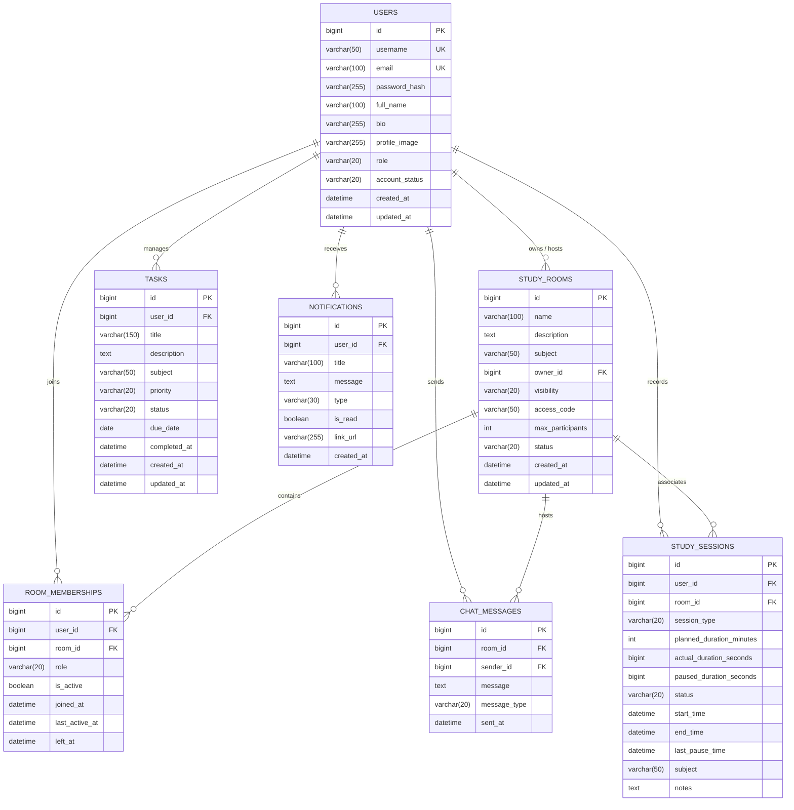

# Focusroom V2 — Entity-Relationship (ER) Diagram & Schema Architecture

## 1. Relational Database Design Overview

The database for Focusroom V2 (`focusroom_db`) is designed using **Third Normal Form (3NF)** and **Boyce-Codd Normal Form (BCNF)** principles. It models a virtual study environment where students can collaborate in digital rooms, synchronize focus sessions, manage academic tasks, exchange messages, and track productivity.

---

## 2. Mermaid Entity-Relationship Diagram

---

## 3. Relational Cardinalities and Structural Integrity

| Relationship | Cardinality | Parent Entity | Child Entity | Foreign Key Constraint | Deletion Behavior |
| :--- | :--- | :--- | :--- | :--- | :--- |
| **Room Ownership** | 1 : N | `users` | `study_rooms` | `fk_room_owner` | `ON DELETE CASCADE` |
| **Room Membership** | M : N | `users` & `study_rooms` | `room_memberships` | `fk_membership_user`, `fk_membership_room` | `ON DELETE CASCADE` |
| **Study Sessions** | 1 : N | `users` | `study_sessions` | `fk_session_user` | `ON DELETE CASCADE` |
| **Room Study Link**| 1 : N (Optional) | `study_rooms` | `study_sessions` | `fk_session_room` | `ON DELETE SET NULL` |
| **Task Ownership** | 1 : N | `users` | `tasks` | `fk_task_user` | `ON DELETE CASCADE` |
| **Room Chat** | 1 : N | `study_rooms` | `chat_messages` | `fk_chat_room` | `ON DELETE CASCADE` |
| **Message Sender** | 1 : N | `users` | `chat_messages` | `fk_chat_sender` | `ON DELETE CASCADE` |
| **Notifications** | 1 : N | `users` | `notifications` | `fk_notification_user` | `ON DELETE CASCADE` |

---

## 4. Key Constraints and Integrity Guarantees

1. **Unique Constraints (`UK`)**:
   - `users(username)`: Prevents duplicate login handles across the entire system.
   - `users(email)`: Guarantees unique email identity.
   - `room_memberships(user_id, room_id)`: Composite unique constraint preventing a student from registering duplicate active memberships in the same room.

2. **Domain Integrity (`CHECK` Constraints)**:
   - `users.role IN ('ROLE_USER', 'ROLE_ADMIN')`
   - `users.account_status IN ('ACTIVE', 'SUSPENDED', 'DEACTIVATED')`
   - `study_rooms.visibility IN ('PUBLIC', 'PRIVATE')`
   - `study_rooms.status IN ('ACTIVE', 'ARCHIVED', 'CLOSED')`
   - `study_rooms.max_participants >= 2 AND study_rooms.max_participants <= 100`
   - `tasks.priority IN ('LOW', 'MEDIUM', 'HIGH', 'URGENT')`
   - `tasks.status IN ('PENDING', 'IN_PROGRESS', 'COMPLETED')`
   - `study_sessions.session_type IN ('FOCUS', 'SHORT_BREAK', 'LONG_BREAK')`
   - `study_sessions.status IN ('IN_PROGRESS', 'PAUSED', 'COMPLETED', 'CANCELLED')`

3. **Referential Integrity**:
   - Foreign keys enforce parent-child relational validity. If an owner account is removed, dependent study rooms and tasks cascade safely without creating orphaned records.
